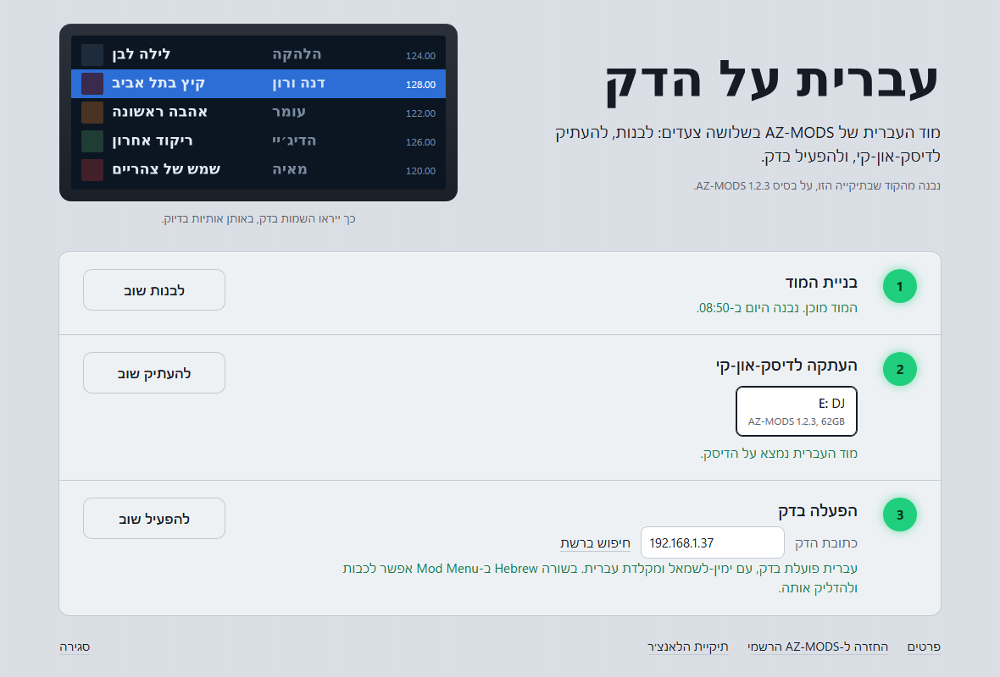

<div dir="rtl">

# עברית ל-XDJ-AZ

מוד עברית ל-[AZ-MODS](https://github.com/Kyle-Hosman/xdj-az-mods) של ה-Pioneer XDJ-AZ. הגופנים של הדק לא כוללים עברית, ולכן שמות של שירים, פלייליסטים ותיקיות בעברית מופיעים כריבועים. עם המוד הזה:

- **אותיות עבריות** בכל מקום שהדק כותב שמות: רשימות, מידע על השיר, הדקים.
- **ימין לשמאל**: עברית נקראת מימין לשמאל, ואנגלית ומספרים נשארים בסדר שלהם, למשל `שיר (Remix)` או `Artist - שיר`. שם ארוך מדי נחתך משמאל עם "...", כך שתחילת השם נשארת על המסך.
- **מקלדת עברית בחיפוש**: מקלדת החיפוש נפתחת בעברית. 123 עובר לאנגלית, ו-ABC בעמוד המספרים חוזר לעברית.

ב-Mod Menu יש לו שורה משלו: **Hebrew**, ובתוכה **Right to Left** ו-**Hebrew Keyboard**.

## התקנה מהדק עצמו (הכי פשוט)

המוד זמין כ-Community Mod, וההתקנה לא צריכה מחשב:

1. בדק: **Mod Menu** ← **Community Mods** ← **Repositories** ← **Add**, ומקלידים:

   ```
   meow3040/xdj-az-hebrew-mod
   ```

2. **Browse** ← **Hebrew** ← **Install**, ואז **Reload**.

אפשר לעשות את אותו הדבר באפליקציית AZ-MODS במחשב, עם **Add repository**. המוד נשאר מותקן גם כש-AZ-MODS מתעדכן. הוא דורש AZ-MODS 1.2.3 ומעלה וקושחה 2.00 או 2.01. פרטים: [community/README.md](community/README.md).

## או: מובנה בתוך AZ-MODS, עם הלאנצ'ר (Windows)

הדרך השנייה בונה את העברית לתוך `azmod.so` של AZ-MODS עצמו.



1. מורידים את הריפו (Code ואז Download ZIP) ומחלצים.
2. לוחצים פעמיים על **`AZ-Hebrew-Launcher.cmd`**. נפתח חלון עם שלושה צעדים:
   - **בניית המוד**: בונה את `azmod.so` עם העברית. בפעם הראשונה יורדים כ-75MB של כלי בנייה, ואחר כך כל בנייה לוקחת כחצי דקה.
   - **העתקה לדיסק-און-קי**: מעתיק את המוד לדיסק שעליו AZ-MODS, ומוסיף מפתח שמאפשר למחשב להתחבר לדק.
   - **הפעלה בדק**: מכניסים את הדיסק ל-USB 1 ומדליקים את הדק. בפעם הראשונה הדק שואל *Allow remote access*, ושם בוחרים Allow. לחיצה אחת מדליקה את העברית ומפעילה מחדש את תוכנת הדק.

מכאן העברית עובדת לבד, בלי מחשב, בכל פעם שהדק עולה עם הדיסק.

**מה צריך:**

- XDJ-AZ עם קושחת AZ-MODS 2.01 (ימין-לשמאל והמקלדת דורשים 2.00 או 2.01; האותיות עובדות בכל גרסה).
- [אפליקציית AZ-MODS](https://github.com/Kyle-Hosman/xdj-az-mods/releases) מותקנת במחשב, ו-AZ-MODS 1.2.3 מותקן דרכה על הדיסק-און-קי.
- Python 3.8 ומעלה מ-python.org, עם ה-py launcher.
- WSL עם Ubuntu: פעם אחת, ב-PowerShell כמנהל, `wsl --install`.
- הדק והמחשב באותה רשת (רק לצעד האחרון).

**לחזור לרשמי:** בתחתית החלון יש "החזרה ל-AZ-MODS הרשמי". הוא מחזיר את `azmod.so` הרשמי לדיסק, ואם הדק הופעל מהלאנצ'ר, גם מסיר ממנו את ההרשאה לבנייה לא חתומה.

**חשוב לדעת:** AZ-MODS טוען בדק רק בניות שחתומות במפתח שלו. כדי שהדק יטען את המוד, צעד ההפעלה מדליק בדק את ההרשאה למפתחים (`azmods-unsigned.on`, [ההסבר של AZ-MODS](https://github.com/Kyle-Hosman/xdj-az-mods/blob/main/BUILDING.md#run-your-own-build-on-your-deck)). עדכון של AZ-MODS מהאפליקציה או מהדק מחליף את `azmod.so` ברשמי, ואז צריך להעתיק את המוד שוב.

## איך זה בנוי

| תיקייה | מה יש בה |
|---|---|
| `azmods/BASE` | גרסת AZ-MODS שהמוד מתאים לה: הריפו, הקומיט (1.2.3) |
| `azmods/files/` | הקבצים החדשים של המוד, במקומות שלהם בעץ של AZ-MODS. הלב: `src/azmod/hebrew.c` |
| `azmods/hebrew.patch` | השינויים הקטנים בקבצים הקיימים של AZ-MODS: השורות ב-Mod Menu, ההתקנה של ה-hooks, טסטים ותיעוד |
| `launcher/` | הלאנצ'ר: `app.py` (המנוע), `web/` (החלון), `build-azmod.sh` (הבנייה ב-WSL), `deck.sh` (מה שרץ בדק) |
| `community/` | גרסת ה-Community Mod: `meow3040-hebrew.c`, `azmod.json`, האייקון |
| `azmods-repo.json` | הקובץ שהדק והאפליקציה קוראים כשמוסיפים את הריפו ב-Community Mods |

הלאנצ'ר מוריד את קוד המקור הרשמי של AZ-MODS לפי הקומיט שב-`BASE`, מוסיף את `files/`, מחיל את `hebrew.patch` ובונה. פירוט טכני: [launcher/README.md](launcher/README.md).

**מה נבדק:** אלגוריתם הכיווניות עבר את כל 91,605 השורות הרלוונטיות בקובץ הבדיקות הרשמי של Unicode. האותיות נבדקו מול FreeType אמיתי בדיוק כמו ש-JUCE בדק קורא לו. כל הכתובות והבתים אומתו מול `EP147` של 2.01. הבנייה תואמת את הבנייה הרשמית, ויש לה טסטים ([launcher/README.md](launcher/README.md)). **מה עוד לא נבדק:** ההרצה על הדק עצמו.

</div>

## English

A Hebrew mod for [AZ-MODS](https://github.com/Kyle-Hosman/xdj-az-mods) on the Pioneer
XDJ-AZ: Hebrew letters wherever the deck writes names, right-to-left lines (the Unicode
Bidirectional Algorithm, with English words and numbers kept in order), and a Hebrew page on
the search keyboard, behind its own Mod Menu row, **Hebrew**.

**Install it from the deck:** Mod Menu > Community Mods > Repositories > Add
`meow3040/xdj-az-hebrew-mod`, then Browse > Hebrew > Install, and Reload (or **Add repository**
in the AZ-MODS desktop app). This is the Community Mods edition (`community/`): it needs AZ-MODS
1.2.3 or newer and firmware 2.00 or 2.01, and it stays installed when AZ-MODS updates.

The other edition is built into AZ-MODS itself. `azmods/` holds the mod as it lands in the
AZ-MODS tree: its own files (`files/`, chiefly
`src/azmod/hebrew.c`), a patch for the AZ-MODS files it hooks into (`hebrew.patch`), and the
AZ-MODS commit it applies to (`BASE`). `launcher/` is a Windows launcher
(`AZ-Hebrew-Launcher.cmd`) that fetches that commit, applies the mod, builds `azmod.so` in WSL
without Docker, copies it to the USB stick and turns it on at the deck over SSH; see
[launcher/README.md](launcher/README.md).

Not an official AZ-MODS release, and not affiliated with AlphaTheta or Pioneer DJ. AZ-MODS is
by Kyle Hosman; this mod is under the same license, GPL-3.0 ([LICENSE](LICENSE),
[NOTICE](NOTICE)).
